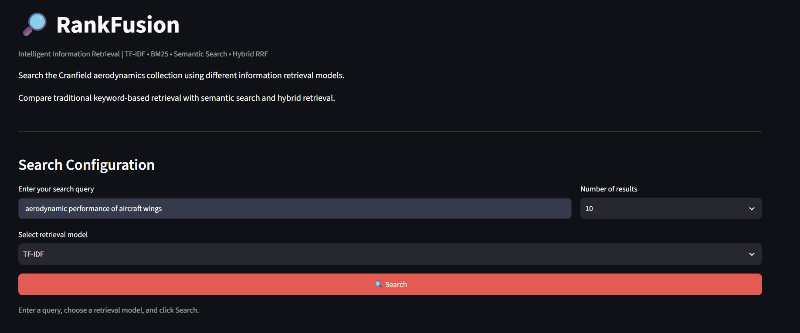
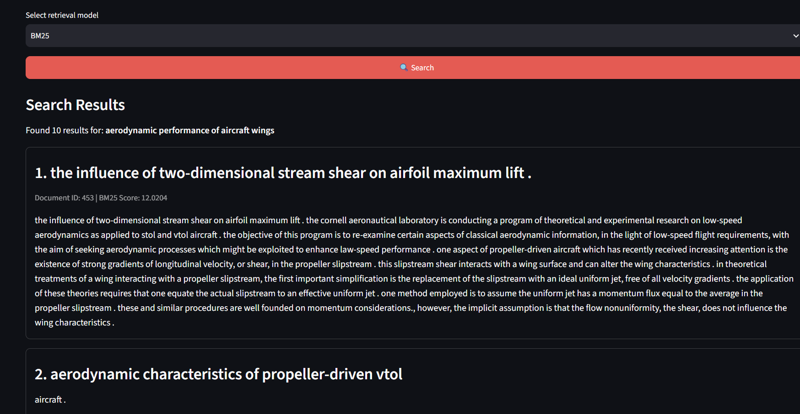
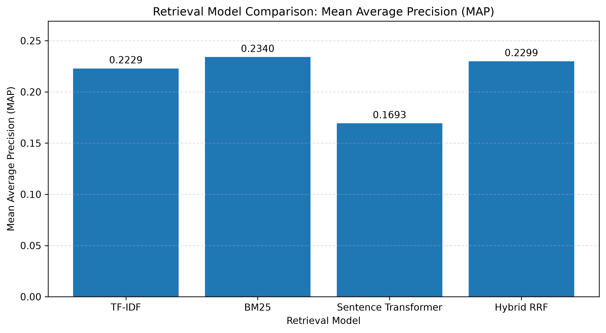
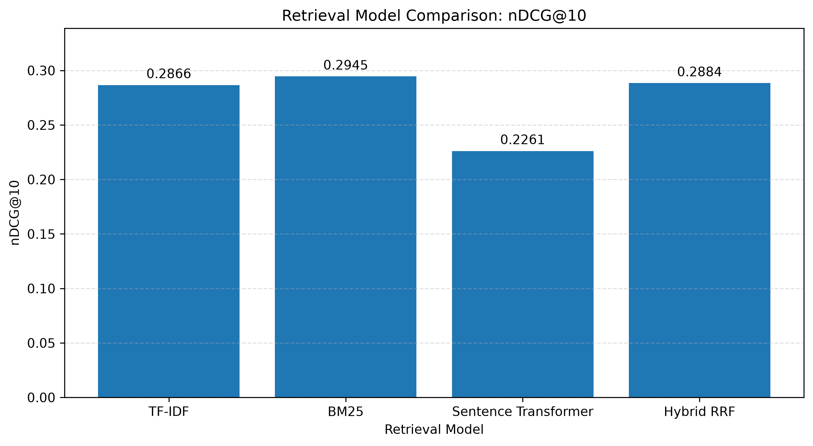
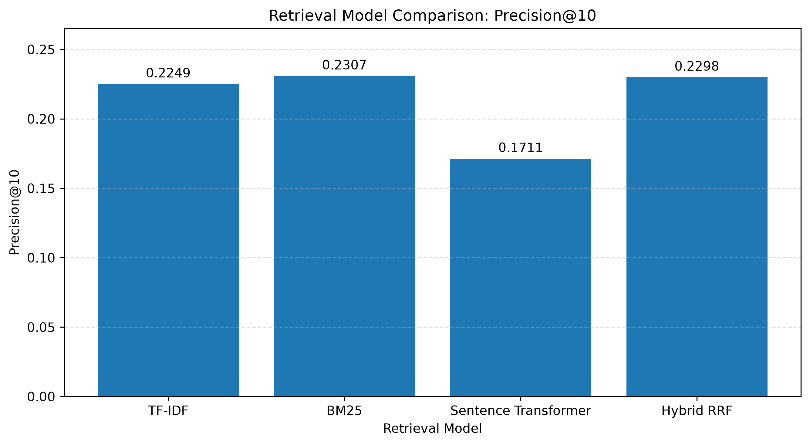
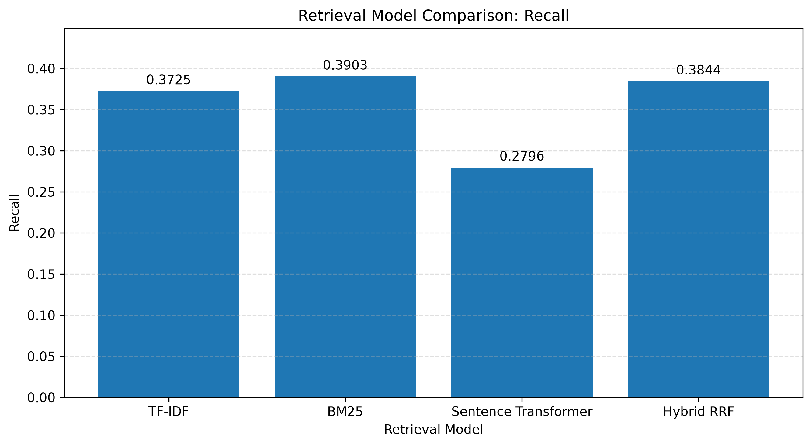

# RankFusion

### Intelligent Information Retrieval and Multi-Model Search Engine

### 🔗 Live Demo
Try RankFusion here: https://rankfusion-fah8xbenmzrxtdfq3n42b3.streamlit.app/


RankFusion is an information retrieval system built on the Cranfield dataset. It compares four retrieval approaches—TF-IDF, BM25, Sentence Transformers, and Hybrid Reciprocal Rank Fusion (RRF)—through an interactive search interface and quantitative evaluation.

The system evaluates retrieval performance using Precision@10, Recall, Mean Average Precision (MAP), and nDCG@10.

## 1. Project Overview

This project implements and compares four information retrieval approaches using the Cranfield collection:

1. TF-IDF
2. BM25
3. Sentence Transformer
4. Hybrid Reciprocal Rank Fusion (RRF)

The system allows users to search a collection of research documents and compare retrieval approaches using standard information retrieval evaluation metrics.

The project includes text preprocessing, document indexing, query processing, document ranking, evaluation metrics, performance visualizations, and an interactive search interface.

## Application Preview

### Dashboard




## 2. Objectives

The main objectives of this project are:

- Implement multiple document retrieval techniques.
- Preprocess documents and queries to improve retrieval.
- Compare lexical, semantic, and hybrid retrieval approaches.
- Evaluate retrieval quality using standard information retrieval metrics.
- Provide an interactive search interface.
- Visualize and compare the performance of different retrieval models.
- Analyze the strengths and limitations of different ranking approaches.

## 3. Technologies Used

The project uses the following technologies and libraries:

- **Python:** Core programming language.
- **NumPy:** Numerical operations.
- **Pandas:** Data handling and analysis.
- **Scikit-learn:** TF-IDF vectorization and related machine learning utilities.
- **NLTK:** Text processing and stemming.
- **Rank-BM25:** BM25-based document ranking.
- **Sentence Transformers:** Semantic text embeddings.
- **Matplotlib:** Evaluation graphs and visualizations.
- **Streamlit:** Interactive search interface.

## 4. Retrieval Models

### 4.1 TF-IDF

Term Frequency–Inverse Document Frequency (TF-IDF) represents documents and queries using numerical vectors based on the importance of terms.

Term frequency measures how often a term appears in a document, while inverse document frequency reduces the importance of terms that appear in many documents.

The system uses TF-IDF vectors to rank documents according to their similarity to a query.

**Advantages:**
- Simple and efficient.
- Easy to interpret.
- Effective when query terms overlap with relevant documents.

**Limitations:**
- Depends heavily on lexical overlap.
- May fail to retrieve relevant documents that use different terminology.

### 4.2 BM25

BM25 is a probabilistic information retrieval ranking algorithm.

It considers term frequency, inverse document frequency, and document-length normalization to calculate the relevance of documents to a query.

Documents with stronger matches to important query terms generally receive higher scores.

**Advantages:**
- Effective for traditional keyword-based retrieval.
- Considers document length.
- Often performs well on standard information retrieval benchmarks.

**Limitations:**
- Primarily relies on matching terms.
- Does not directly understand semantic relationships between words.

### 4.3 Sentence Transformer

Sentence Transformers generate dense vector representations, also called embeddings, for text.

The system represents documents using embeddings and compares them with query embeddings using cosine similarity.

This allows the retrieval model to identify semantic similarity even when the query and document do not use exactly the same words.

The implementation uses the pretrained model:

`sentence-transformers/all-MiniLM-L6-v2`

**Advantages:**
- Captures semantic relationships.
- Can identify conceptually related documents.
- Is less dependent on exact keyword matching.

**Limitations:**
- Requires additional computational resources.
- Retrieval quality depends on the embedding model and text representation.
- May perform differently across datasets and query types.

### 4.4 Hybrid Reciprocal Rank Fusion (RRF)

The Hybrid RRF model combines the rankings produced by TF-IDF, BM25, and Sentence Transformer.

Instead of directly combining their raw scores, Reciprocal Rank Fusion combines document rankings.

The RRF score is calculated as:

\[
RRF(d) = \sum_{m \in M} \frac{1}{k + rank_m(d)}
\]

Where:

- \(d\) is a document.
- \(M\) is the set of retrieval models.
- \(rank_m(d)\) is the rank of document \(d\) according to model \(m\).
- \(k\) is a constant used to control the contribution of document ranks.

A document that appears near the top of multiple rankings can receive a higher combined score.

The current implementation uses an RRF constant of 60.

**Advantages:**
- Combines different retrieval approaches.
- Does not require raw scores from different models to be directly comparable.
- Can benefit from complementary ranking signals.

**Limitations:**
- Requires multiple retrieval models.
- Adds computational overhead.
- Performance depends on the component models and ranking configuration.

## 5. Dataset

The project uses the Cranfield information retrieval collection.

The downloaded dataset contains:

- **1,400 documents**
- **225 queries**
- **1,837 relevance judgments**

The dataset includes research documents, search queries, and relevance judgments that indicate how relevant documents are to particular queries.

The relevance judgments are used to evaluate the retrieval models.

### Dataset Organization

The raw dataset is stored in:

- `data/raw/documents.jsonl`
- `data/raw/queries.jsonl`
- `data/raw/qrels.tsv`

Preprocessed data is stored in:

- `data/processed/documents_processed.jsonl`
- `data/processed/queries_processed.jsonl`

The preprocessing pipeline preserves the original document and query information while adding processed text and tokens.

## 6. Evaluation Metrics

The retrieval models are evaluated using four standard information retrieval metrics.

### 6.1 Precision@10

Precision@10 measures the proportion of the top 10 retrieved documents that are relevant.

\[
P@10 = \frac{\text{Relevant documents in top 10}}{10}
\]

A higher value indicates that a larger proportion of the top 10 results are relevant.

### 6.2 Recall

Recall measures the proportion of all relevant documents that the system successfully retrieves.

\[
Recall = \frac{\text{Relevant documents retrieved}}{\text{Total relevant documents}}
\]

A higher recall indicates that the system retrieves a larger proportion of the relevant documents.

### 6.3 Mean Average Precision (MAP)

Average Precision evaluates the ranking of relevant documents for an individual query.

Mean Average Precision calculates the mean of Average Precision values across the evaluated queries.

MAP rewards systems that retrieve relevant documents near the top of the ranking.

A higher MAP generally indicates better overall ranking quality.

### 6.4 Normalized Discounted Cumulative Gain at 10 (nDCG@10)

nDCG@10 evaluates the quality of the top 10 ranked documents while considering their relevance grades and positions.

Documents ranked higher contribute more to the score than documents ranked lower.

The implementation uses the original graded relevance judgments, with larger relevance grades contributing greater gain.

### Relevance Conventions

For binary relevance metrics, documents with relevance judgments greater than zero are treated as relevant.

For nDCG, the original graded relevance judgments are retained.

The evaluation is conducted across the 225 queries in the current dataset.
---

## 📊 Evaluation and Performance

RankFusion evaluates four retrieval approaches on the Cranfield dataset
using standard information retrieval metrics.

### Mean Average Precision (MAP)



### Normalized Discounted Cumulative Gain at 10 (nDCG@10)



### Precision at 10 (P@10)


### Recall


## 7. Project Structure

The project is organized into separate directories for data, preprocessing, retrieval, evaluation, visualization, testing, and the interactive application.

```text
cranfield-ir-system/
├── config/
├── data/
│   ├── raw/
│   │   ├── documents.jsonl
│   │   ├── queries.jsonl
│   │   └── qrels.tsv
│   └── processed/
│       ├── documents_processed.jsonl
│       └── queries_processed.jsonl
├── docs/
├── experiments/
├── outputs/
│   ├── examples/
│   ├── graphs/
│   ├── rankings/
│   ├── tables/
│   └── metrics/
├── report/
│   └── figures/
├── src/
│   ├── data/
│   │   ├── download_dataset.py
│   │   └── validate_dataset.py
│   ├── evaluation/
│   │   ├── evaluate_models.py
│   │   └── metrics.py
│   ├── preprocessing/
│   │   ├── preprocess_dataset.py
│   │   └── text_preprocessor.py
│   ├── retrieval/
│   │   ├── tfidf.py
│   │   ├── bm25.py
│   │   ├── sentence_transformer.py
│   │   └── hybrid.py
│   ├── utils/
│   └── visualization/
│       ├── plot_results.py
│       └── plot_precision_recall.py
├── tests/
│   ├── test_bm25_manual.py
│   ├── test_hybrid_manual.py
│   ├── test_metrics_manual.py
│   ├── test_sentence_transformer_manual.py
│   └── test_tfidf_manual.py
├── app.py
├── requirements.txt
└── README.md
```

## 8. Installation

Follow these steps to set up the project on your local machine.

### Prerequisites

- Python installed on your system.
- Git, if you want to clone the repository.
- A terminal or command prompt.

### Step 1: Open the Project Directory

Open the `cranfield-ir-system` project directory in VS Code.

### Step 2: Create a Virtual Environment

Run the following command in the project terminal:

```bash
python -m venv .venv
```

### Step 3: Activate the Virtual Environment

On Windows PowerShell:

```powershell
.\.venv\Scripts\Activate.ps1
```

### Step 4: Install Dependencies

Install the required Python packages:

```bash
python -m pip install -r requirements.txt
```

The dependencies include the libraries required for preprocessing, retrieval, evaluation, visualization, and the Streamlit interface.

## 9. Running the Application

The project provides an interactive search interface built with Streamlit.

### Start the Application

From the root directory of the project, run:

```bash
python -m streamlit run app.py
```

Streamlit will start the application and display the local address in the terminal.

Open that address in your browser.

### Using the Search Interface

The interface allows users to:

1. Enter a search query.
2. Select a retrieval model.
3. Specify the number of results to display.
4. View ranked documents.
5. Inspect document titles, document IDs, scores, and readable document text.
6. Compare the results produced by different retrieval models.

The available retrieval models are:

- TF-IDF
- BM25
- Sentence Transformer
- Hybrid RRF

## 10. Reproducing the Experiments

The following commands reproduce the major stages of the pipeline.

Run these commands from the project root directory with the virtual environment activated.

### Step 1: Download the Dataset

```bash
python -m src.data.download_dataset
```

This downloads the Cranfield collection and saves the raw dataset files.

### Step 2: Validate the Dataset

```bash
python -m src.data.validate_dataset
```

This checks the downloaded dataset for expected structure and data consistency.

### Step 3: Preprocess the Dataset

```bash
python -m src.preprocessing.preprocess_dataset
```

This processes the document and query text and saves the processed files in `data/processed/`.

### Step 4: Evaluate the Retrieval Models

```bash
python -m src.evaluation.evaluate_models
```

This evaluates the four retrieval models across the dataset queries.

The evaluation script calculates Precision@10, Recall, MAP, and nDCG@10 and saves the model comparison results.

It also generates the macro-averaged precision-recall curve.

### Step 5: Generate Model Comparison Graphs

```bash
python -m src.visualization.plot_results
```

This generates visual comparisons of the retrieval models using the saved evaluation results.

The commands above assume that the required dataset files and Python dependencies are available.

## 11. Current Evaluation Results

The following results were obtained from the current implementation across 225 queries.

| Model | Precision@10 | Recall | MAP | nDCG@10 |
|---|---:|---:|---:|---:|
| TF-IDF | 0.2249 | 0.3725 | 0.2229 | 0.2866 |
| BM25 | 0.2307 | 0.3903 | 0.2340 | 0.2945 |
| Sentence Transformer | 0.1711 | 0.2796 | 0.1693 | 0.2261 |
| Hybrid RRF | 0.2298 | 0.3844 | 0.2299 | 0.2884 |

### Observations

**BM25**

BM25 achieved the highest values across all four reported evaluation metrics in this experiment. It obtained a Precision@10 of 0.2307, Recall of 0.3903, MAP of 0.2340, and nDCG@10 of 0.2945.

**TF-IDF**

TF-IDF performed competitively, with a Precision@10 of 0.2249 and MAP of 0.2229. It provides a straightforward lexical retrieval baseline.

**Sentence Transformer**

Sentence Transformer obtained lower scores than the other models in this experiment. Its results indicate that semantic embeddings did not outperform the lexical methods under the current experimental configuration.

**Hybrid RRF**

Hybrid RRF achieved results close to those of BM25 and TF-IDF. Its Precision@10 was 0.2298, while its MAP was 0.2299.

### Discussion

The results show that BM25 was the strongest model among the four approaches under the current experimental setup.

The Hybrid RRF model performed competitively but did not surpass BM25. This suggests that combining ranking methods does not automatically guarantee better retrieval performance.

The Sentence Transformer model performed less effectively than the lexical models in this experiment. Its performance may depend on factors such as text preprocessing, embedding representation, and model suitability for the dataset.

These findings apply to the current implementation, preprocessing pipeline, model configuration, and evaluation procedure. Different configurations may produce different results.

## 12. Visualizations

The project generates visualizations to help compare retrieval model performance.

### 12.1 Precision@10 Comparison

This chart compares the proportion of relevant documents among the top 10 results returned by each retrieval model.

### 12.2 Recall Comparison

This chart compares how many relevant documents each model retrieves relative to the total number of relevant documents.

### 12.3 Mean Average Precision Comparison

This chart compares the ranking quality of the retrieval models across the evaluated queries.

### 12.4 nDCG@10 Comparison

This chart compares the quality of the top 10 results while accounting for document positions and graded relevance.

### 12.5 Precision-Recall Curve

The macro-averaged precision-recall curve compares interpolated precision across recall levels for the four retrieval models.

The curve provides a visual comparison of how precision changes as recall increases.

### Generated Files

The comparison graphs are saved under:

`outputs/graphs/`

The macro-averaged precision-recall curve is saved as:

`outputs/graphs/precision_recall_curve.png`

The comparison charts are also copied to:

`report/figures/`

These visualizations can be used when analyzing and reporting the experimental results.

## 13. Limitations and Future Improvements

Although the project implements multiple retrieval approaches and evaluates their performance, several improvements are possible.

### 13.1 Deeper Retrieval Evaluation

The current evaluation uses the top 10 documents for ranking metrics such as Precision@10 and nDCG@10.

Retrieving more documents for precision-recall analysis would provide a broader view of retrieval performance.

### 13.2 Text Preprocessing

The current preprocessing pipeline uses lowercasing, punctuation removal, stopword removal, and stemming.

Alternative preprocessing strategies could be investigated to determine their effects on lexical and semantic retrieval.

### 13.3 BM25 Parameter Tuning

The BM25 model could be evaluated using different parameter configurations to determine whether its retrieval performance can be improved.

### 13.4 Semantic Retrieval Improvements

Alternative pretrained embedding models could be tested to investigate whether they improve semantic retrieval on the Cranfield collection.

### 13.5 Hybrid Ranking Strategies

Different ranking fusion methods and configurations could be compared with Reciprocal Rank Fusion.

### 13.6 Automated Testing

The existing manual tests could be expanded into a more comprehensive automated test suite.

This could include tests for preprocessing, ranking behavior, evaluation metrics, and application functionality.

### 13.7 Experiment Logging

More detailed experiment logging could record model settings, preprocessing choices, evaluation configurations, and output files to improve reproducibility.

## 14. Reproducibility Notes

The reported evaluation results reflect the current implementation and configuration.

Results may change if any of the following are modified:

- Dataset version or contents.
- Text preprocessing procedure.
- Retrieval model implementation.
- Sentence Transformer model.
- Ranking parameters.
- Evaluation cutoff.
- Relevance conventions.
- Software dependencies.

For consistent comparisons, all retrieval models should be evaluated using the same dataset, query set, relevance judgments, and evaluation conventions.

The evaluation script saves the current model comparison results to:

`outputs/metrics/model_comparison.csv`

The generated visualizations are stored in `outputs/graphs/`, with comparison figures also saved in `report/figures/`.

The reported metrics should be interpreted as experimental results for the current system rather than as guaranteed performance for other datasets or retrieval settings.
